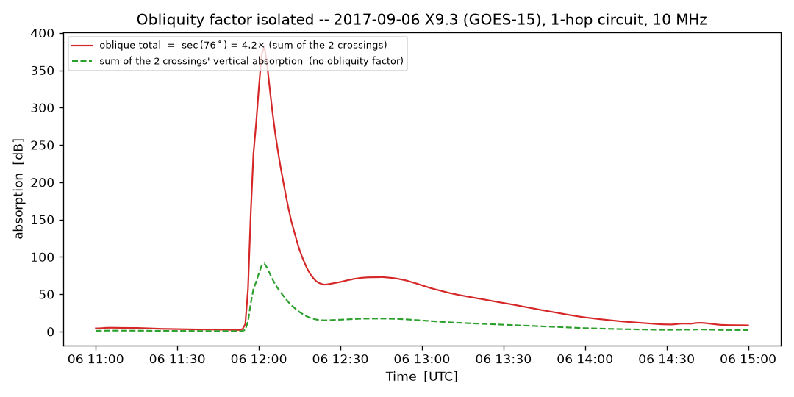
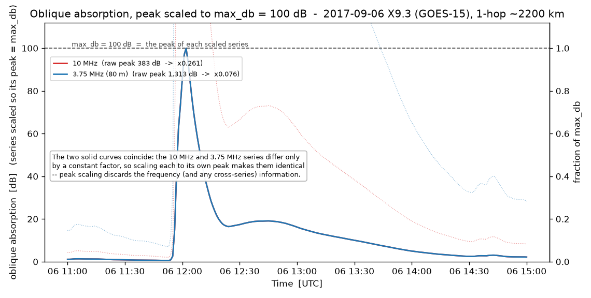

# Oblique-path (multi-hop) HF absorption

`xrap.absorption.absorption()` gives **vertical** D-region absorption at a
single sub-ionospheric point. A real HF circuit is oblique: the wave leaves
the transmitter at some elevation angle, is bent back by the F layer one or
more hops later, and crosses the D region **twice per hop** (up, then down),
generally at different locations and at a steep angle from vertical.
`src/xrap/oblique.py` extends the vertical models to that geometry. This note
derives the equations it implements and validates them against the code.

> **Correction notice.** The first version of this module (commit `f28ac01`)
> had three errors, all fixed in the current code and documented in
> [§7](#7-corrections-to-the-first-version): the obliquity law was
> `sec(chi)^(n+1)` instead of `sec(chi_D)`, the incidence angle was taken at
> the F-layer reflection height instead of the D region, and the D-region
> crossing positions used a linear approximation. Figures labelled "X9.3" in
> earlier docs also used a flux ~1.43x too large (see [model.md](model.md#flux-scale-read-this-first)).

## 1. Non-deviative absorption: the secant law

D-region absorption is *non-deviative*: the plasma there is far too thin to
bend the ray, so the wave crosses it in a straight line at the **actual** wave
frequency. For a plane-stratified layer with electron density `N(h)`, collision
frequency `nu(h)` and refractive index `mu`, the power-absorption coefficient
(nepers per metre) is the standard

    kappa = C * N * nu / ( mu * (omega^2 + nu^2) )                          (1)

[Davies, 1990, Ch. 3; Budden, 1961]. A ray at local angle `theta` from vertical
travels `ds = dh / cos(theta)`, and Snell's law in a stratified medium gives
`mu sin(theta) = sin(phi0)` with `phi0` the incidence angle at the bottom of the
layer, so `cos(theta) = sqrt(mu^2 - sin^2(phi0)) / mu`. Hence along the
oblique path

    kappa ds = C N nu dh / ( (omega^2 + nu^2) * sqrt(mu^2 - sin^2(phi0)) )  (2)

while the **vertical** path at the *same* frequency has
`kappa dh = C N nu dh / ( mu (omega^2 + nu^2) )`. Their ratio at every height is

    oblique / vertical = mu / sqrt(mu^2 - sin^2(phi0))
                       = sqrt(1 - X) / sqrt(cos^2(phi0) - X)   ->   sec(phi0)   (3)

where `X = (plasma frequency / wave frequency)^2` and the limit holds wherever
`X << 1` -- i.e. throughout the D region at HF. The ratio only departs from
`sec(phi0)` near the reflection level (`X -> cos^2(phi0)`), which is the
*deviative* region, not the D region. Therefore, with `chi_D` the incidence angle
at the absorbing height,

    L_oblique(f, chi_D) = sec(chi_D) * L_vertical(f)                        (4)

**at the same frequency `f`, whatever the exponent `n` in `L_vertical ~ f^-n`.**
`obliquity_factor(chi_D)` implements `sec(chi_D)`.

**Consistency with the standards.** ITU-R P.533-14 eq. (20) has exactly this
structure: one `sec i` factor and an actual-frequency `(f + f_L)^-2`; the
equivalent vertical frequency `f_v = f cos i` enters only through a bounded
"penetration factor" `phi_n(f_v / foE)`, not as a power of `cos`. Its absorption
penetration points are at 90 km, with the incidence angle evaluated at E/D-region
heights (110 km in eq. 20, 90 km in the LUF eq. 33) -- never at the F-layer
reflection height [ITU-R P.533-14, §5.2.2, §5.3.2].

**What Martyn's theorem does and does not say.** Martyn's equivalence theorem
[Martyn, 1935] relates an oblique wave to a *vertical* wave of frequency
`f cos(phi0)` that reflects at the same level. Redoing the algebra above for
that vertical wave (`omega -> omega cos(phi0)`) shows that, in the high-frequency
limit `nu << omega`, `L_oblique(f) = cos(phi0) * L_vertical(f cos phi0)`. With
`L_vertical ~ f^-2` that is identical to (4); for any other exponent it is not,
and because the D region is non-deviative (4) is the right statement. The
equivalent-frequency form is useful for the *reflection* condition
(§4), but **must not be multiplied by an additional `sec`** -- doing so
double-counts the obliquity and gives `sec^(n+1)`, the error corrected in §7.

The total absorption along a real path sums (4) over every D-region crossing
(`hop_crossings`), each with its *own* incidence angle and its *own* solar zenith
angle (via `solar_zenith_angle`, since different crossings can be at very
different latitudes / local times):

    L_total = sum_i  sec(chi_D,i) * L_vertical(f, SZA_i, flux)              (5)

## 2. Geometry

### 2.1 At the reflection point (the "mirror")

For a hop of ground range `d` reflecting at virtual height `h`, put the Earth's
centre at the origin, the transmitter at radius `R` and the mirror `M` at radius
`R + h`, angularly `delta = d / (2R)` away. The ray is a straight line in vacuum
between TX and `M` (the usual virtual-mirror model), so **Bouguer's theorem**
for a spherically symmetric medium -- `r sin(theta(r)) = const` for `n = 1`
[Budden, 1961; Davies, 1990] -- evaluated at the transmitter (angle from local
vertical `90 deg - beta`, `beta` = elevation) and at `M` (angle `chi_h`) gives

    R cos(beta) = (R + h) sin(chi_h)
    =>  sin(chi_h) = R cos(beta) / (R + h)                                  (6)

and the plane geometry of (Earth centre)-(TX)-(`M`) gives the elevation angle

    tan(beta) = [cos(delta) - R / (R + h)] / sin(delta)                     (7)

`incidence_angle(d, h)` returns `(chi_h, beta)`. (Flat earth: `tan beta = 2h/d`,
`chi = 90 deg - beta`; (6)-(7) reduce to this as `R -> infinity`.)

### 2.2 At the D region -- the angle the secant law needs

Bouguer's invariant (6) holds at **every** radius along the ray, so at the
absorbing height `h_D` (default 90 km)

    sin(chi_D) = R cos(beta) / (R + h_D)                                    (8)

Because `R + h_D < R + h`, **`chi_D > chi_h` on a curved Earth**: the ray's angle
from the local vertical grows toward the ground, as the vertical direction
rotates beneath a straight ray. For `h = 300 km`, `h_D = 90 km`:

| hop `d` (km) | elevation `beta` | `chi_h` at 300 km | `chi_D` at 90 km | `sec(chi_D) / sec(chi_h)` |
|---|---|---|---|---|
| 1500 | 18.0 deg | 65.3 deg | 69.7 deg | 1.21 |
| 2500 | 7.5 deg | 71.2 deg | 77.8 deg | 1.53 |
| 3500 | 1.6 deg | 72.7 deg | 80.3 deg | 1.77 |

On a flat Earth the two angles are equal; the difference is pure curvature and
grows with hop length. `crossing_geometry(beta, h_D)` returns `chi_D` from (8).

### 2.3 Where the D-region crossings are

In triangle (Earth centre)-(TX)-`P`, with `P` the point on the ray at radius
`r = R + h_D`, the angle at TX is `90 deg + beta` and the angle at `P` is
`chi_D`, so the central angle between TX and the sub-point of `P` is

    psi = 90 deg - beta - chi_D        =>   ground range to the crossing = R psi   (9)

(flat: `h_D / tan(beta)`). This is exact for the straight chord; at `r = R + h`
it reproduces `psi = delta` (half the hop) -- checked in the test suite. The
descending crossing is the mirror image, `d - R psi` from the hop's start. For
`n_hops` hops the path is split into equal ground-range hops, each with its own
apex, giving `2 * n_hops` crossings. `hop_crossings()` implements this and then
converts each ground range to (lat, lon) by great-circle (or linear, for
`earth_model="flat"`) interpolation between the transmitter and receiver.

## 3. Earth model

`earth_model="curved"` (default) uses (6)-(9) and great-circle (haversine)
distance; `earth_model="flat"` uses the planar forms and an equirectangular
distance (fine to a few thousand km, no pole / date-line handling). Both are
user-selectable.

## 4. Reflection height: fixed vs. quasi-parabolic

`incidence_angle` needs the virtual reflection height `h`. Two models, selected
by `height_model=`:

**`"fixed"`** -- a single scalar `height_km`, independent of frequency (P.533
also uses a fixed 300 km for its penetration-point geometry).

**`"parabolic"`** -- an idealised quasi-parabolic (QP) F2 layer
[Croft & Hoogasian, 1968]:

    f_N(r)^2 = foF2^2 * [ 1 - ((r - r_m) / y_m)^2 ]                         (10)

(`r_m = R + hmF2`, `y_m = ym_km`). For a **vertical** wave the reflection height
solves (10) at `f_N = f`:

    h_vertical(f) = hmF2 - ym * sqrt(1 - (f / foF2)^2)                      (11)

For an **oblique** wave, Martyn's theorem is the right tool *here*: reflection
depends on the equivalent vertical frequency `f' = f cos(chi_h)` (with `chi_h`
the mirror-level angle (6)), but `chi_h` itself depends on the unknown `h`.
`reflection_height()` solves this by fixed-point iteration -- guess `h`
(seeded at `hmF2`), get `chi_h` from (6)-(7), form `f' = f cos(chi_h)`, get a new
`h` from (11) with `f'` in place of `f` -- to convergence. Since `f' <= f` and a
pre-check rejects `f > foF2`, obliquity only ever *helps* reflection (the oblique
MUF `foF2 sec(chi)` always exceeds `foF2`).

**Not implemented:** full analytic QP ray tracing [Croft & Hoogasian, 1968]
(curved path inside the layer, deviative effects, magnetoionic O/X splitting).
The secant-law-with-a-QP-layer simplification introduces error mainly very
close to the MUF.

## 5. Worked example and validation

A single hop of 2193.5 km (southern Greece to north-eastern France:
`tx = (35N, 25E)`, `rx = (48N, 5E)`), 10 MHz, `height_model="fixed"`,
`height_km = 300`, during the 2017-09-06 **X9.3** flare. The flux is GOES-15 on
the flare-class scale (`fetch_goes_xrs` applies the 0.7 factor), peaking at
`9.3606e-4 W/m^2` = X9.36 at 12:02 UT.

| quantity | value |
|---|---|
| elevation `beta` | 10.00 deg |
| incidence at the mirror (300 km), `chi_h` | 70.14 deg |
| **incidence at the D region (90 km), `chi_D`** | **76.19 deg** |
| `sec(chi_D)` (the obliquity factor, eq. 4) | 4.190 |
| "up" crossing: (37.76N, 21.73E), 423.9 km from TX, SZA 37.63 deg | `L_v` = 46.536 dB |
| "down" crossing: (45.78N, 9.54E), 1769.6 km from TX, SZA 40.55 deg | `L_v` = 44.646 dB |
| sum of the two vertical absorptions (green) | 91.18 dB |
| oblique total (red, eq. 5) | 382.06 dB |
| **measured ratio red / green** | **4.190** |

The measured ratio equals the analytic `sec(chi_D)` to all printed digits
(`grazing=False` for both curves so the comparison is exact; the default
`grazing=True` for XRAP shifts both by ~0.2%). Regenerate with
`python docs/make_oblique_figures.py` (needs network). The window starts at
11:00 UT because GOES-15's `xrsb` is flagged bad (quality 2) at 09:00-09:29 UT
that day.

For comparison, the first version of this module (`sec^2.5` at the mirror angle)
would have used a factor of `70.14 deg -> sec^2.5 = 14.87` here -- 3.55x the
corrected value.

**Reading the numbers.** Even the corrected 382 dB is not a literal link-budget
figure: it is far beyond any circuit's margin and simply means "complete
blackout". See the blackout-cap guidance below.

### 5.1 Low-frequency saturation and `max_db` peak scaling

**Saturation.** The vertical `(30/f)^1.5` law diverges toward 0 Hz (22.6x at
3.75 MHz, 68x at 1.8 MHz, 465x at 0.5 MHz). XRAP therefore saturates it below a
corner `freq_saturation_mhz` (default **5 MHz**; user-selectable per call, via
`coeffs`, `AbsorptionModel(freq_saturation_mhz=)` or `--freq-saturation`; `None`
disables it):

    S(f) = (30/f)^n                       f >= f_s
    S(f) = 2 * 30^n / (f^n + f_s^n)       f <  f_s                          (12)

(`n = 1.5`). Both branches equal `(30/f_s)^n` at `f_s`, so the law is continuous,
the validated power law above `f_s` is left exactly unchanged, and the scaling is
bounded by `2 (30/f_s)^n = 29.4` as `f -> 0` instead of diverging. The physical
idea: D-region collisions dominate at low frequency, so `kappa ~ N nu / (nu^2 +
omega^2)` stops depending on `omega` (eq. 1). 5 MHz is a deliberately
conservative corner -- a rough estimate puts the true collisional corner
`nu / 2 pi` at ~0.2-3 MHz depending on height (not verified here) -- so tune it
with the data. DRAP2 keeps its published, unsaturated form unless you opt in.
The obliquity factor does not depend on frequency, so saturation and obliquity
simply multiply.

Example, 80 m (3.75 MHz), flux `9e-4` (X9.0, class scale), tx/rx near the
sub-solar region, `height_km = 300`:

| path | unsaturated | saturated (default) |
|---|---|---|
| vertical, one crossing (overhead Sun) | 246 dB | 194 dB |
| 1500 km, 1 hop | 1,244 dB | 979 dB |
| 3000 km, 1 hop | 2,212 dB | 1,742 dB |
| 6000 km, 2 hops | 3,530 dB | 2,780 dB |

(At 1.8 MHz the vertical value drops from 741 dB to 263 dB.) **Saturation removes
the divergence toward low frequency, but it does not make X-class values small:**
`12080 x 9e-4 = 10.9 dB` at 30 MHz times a scaling of ~18-29, times `sec(chi_D)`
up to 6.0 per crossing, times `2n` crossings, is intrinsically far beyond any
circuit's margin. Those values mean "blackout".

**`max_db`: peak scaling.** `oblique_absorption(..., max_db=...)` (and
`absorption(..., max_db=...)`) multiplies the **whole returned time series by one
factor so that its peak equals `max_db`** -- only if the peak exceeds it; it never
scales up (`xrap.peak_scale(values, max_db)` returns the scaled array and the
factor). The shape of the series is preserved, so there is no flat top. A scalar
result above `max_db` simply becomes `max_db`. Things to keep in mind:

- the factor depends on the **window you pass** (a longer window containing a
  bigger flare changes it);
- **quiet values are rescaled too** (a 2.5 dB pre-flare value becomes 0.65 dB when
  the peak is scaled by x0.26), not just the flare;
- series scaled separately (different frequencies, paths, days) are **no longer
  comparable** with each other in magnitude -- in the figure below the 10 MHz and
  3.75 MHz curves become *identical*, because they differ only by a constant
  frequency factor that peak scaling removes;
- `result >= max_db` is no longer a blackout flag -- only the peak sits on it.

(`max_db` / `max_db_mode` are also on `AbsorptionModel` and `xrap predict --max-db`;
there the unlimited values are kept in an `absorption_raw_db` column.)

`max_db_mode="clip"` restores the hard cut (`np.minimum`, so `result >= max_db`
means blackout, and values below it are untouched). Pick `max_db` at or above the
largest clear-sky SNR of any circuit you model if you use the cut; call with
`max_db=None` for the raw value. See `docs/make_maxdb_figure.py`.

## 6. Scope

Implemented: non-deviative D-region absorption (eq. 4-5), flat- or curved-earth
hop / crossing geometry with the incidence angle at the D-region height
(§2-3), fixed or quasi-parabolic reflection height (§4), low-frequency
saturation of the vertical law and an optional `max_db` peak scaling / clip (§5.1).

Not implemented (see also [model.md](model.md)): SNR / link budget (free-space
path loss, antenna gain, noise floor); full ray tracing (deviative absorption,
magnetoionic O/X mode splitting, exact Croft-Hoogasian QP solutions); the
ITU-R P.533 penetration factor `phi_n(f_v/foE)` and gyrofrequency term; use of
the GOES `xrsb_quality` flags (they are returned but not filtered).

## 7. Corrections to the first version

Commit `f28ac01` (2026-09-14) shipped with these errors; all are fixed in the
code, the tests, and this document.

1. **Obliquity law.** It used `sec(chi) * L_vertical(f cos chi)`, i.e.
   `sec(chi)^(n+1) = sec^2.5` -- the secant path-length factor *and* a
   Martyn-style frequency shift, double-counting the obliquity. The correct
   non-deviative law is `sec(chi_D) * L_vertical(f)` (eq. 4), independent of
   `n`. A regression test (`test_obliquity_does_not_depend_on_the_frequency_exponent`)
   checks that the oblique/vertical ratio is `sec(chi_D)` for `n = 0.5, 1.5, 2`.
2. **Incidence angle at the wrong height.** It was evaluated at the F-layer
   reflection height (`chi_h`) instead of the D region (`chi_D`), contradicting
   the Bouguer invariant used to derive (6). On a curved Earth `chi_D > chi_h`
   (table in §2.2). Found in an external review of the code.
3. **Crossing positions.** They were located with a linear
   `(h_D / h) * (d / 2)` rule; the exact chord intersection (9) differs by ~95 km
   on the worked example (up-crossing at 423.9 km vs 329.0 km).

Fixing (2) alone would have made the error *worse* (it raises the obliquity
factor 1.6-4.2x); the net effect of (1)+(2) is a ~3-3.6x *reduction* for hops of
1500-3500 km.

**Flux scale.** Separately, "X9.3" results in earlier figures used science-quality
GOES-16 flux (`1.46e-3`, ~X14.6 on the class scale) instead of the class-scale
`9.3e-4`; XRAP is linear in flux, so those absorption values were ~1.57x too
large (77 dB vs 49 dB at 10 MHz, 20N 30E). `fetch_goes_xrs` now returns
class-scale flux by default -- see [model.md](model.md#flux-scale-read-this-first).

## References

1. Davies, K. (1990). *Ionospheric Radio*. IEE Electromagnetic Waves Series 31.
   Peter Peregrinus Ltd / IET. -- non-deviative absorption, the absorption
   coefficient (eq. 1), and MUF / hop geometry (Ch. 3).
2. Martyn, D. F. (1935). The propagation of medium radio waves in the
   ionosphere. *Proceedings of the Physical Society*, 47(2), 323-339. --
   oblique/vertical equivalence theorem (used here for the *reflection*
   condition, §4).
3. Budden, K. G. (1961). *Radio Waves in the Ionosphere*. Cambridge University
   Press. -- Bouguer's theorem / ray invariant for spherically stratified media
   (eq. 6, 8); Snell's law and the absorption coefficient in stratified media.
4. Hargreaves, J. K. (1992). *The Solar-Terrestrial Environment*. Cambridge
   University Press. -- D-region absorption background.
5. Croft, T. A., & Hoogasian, H. (1968). Exact ray calculations in a
   quasi-parabolic ionosphere with no magnetic field. *Radio Science*, 3(1),
   69-74. -- quasi-parabolic layer (eq. 10); this module uses the simplified
   secant-law version, not the full ray-tracing solution given there.
6. ITU-R Recommendation P.533-14 (08/2019). *Method for the prediction of the
   performance of HF circuits*. International Telecommunication Union.
   [PDF](https://www.itu.int/dms_pubrec/itu-r/rec/p/R-REC-P.533-14-201908-I!!PDF-E.pdf)
   -- eq. (13), (19) (elevation angle / slant range), eq. (20)-(22) (absorption
   loss: single `sec i`, actual-frequency `(f + f_L)^-2`, penetration points at
   90 km, fixed 300 km reflection height) and eq. (33) (`i_90`).
7. Parthasarathy, R., et al. (1963), as analysed by Hargreaves -- multi-frequency
   absorption measurements behind the `n = 1.5` frequency exponent shared by the
   bundled vertical models (see [model.md](model.md) and Fiori et al. below).
   Full bibliographic details not verified here.
8. Fiori, R. A. D., Chakraborty, S., & Nikitina, L. (2022). Data-based
   optimization of a simple shortwave fadeout absorption model. *Journal of
   Atmospheric and Solar-Terrestrial Physics*, 230, 105843.
   [doi:10.1016/j.jastp.2022.105843](https://doi.org/10.1016/j.jastp.2022.105843)
